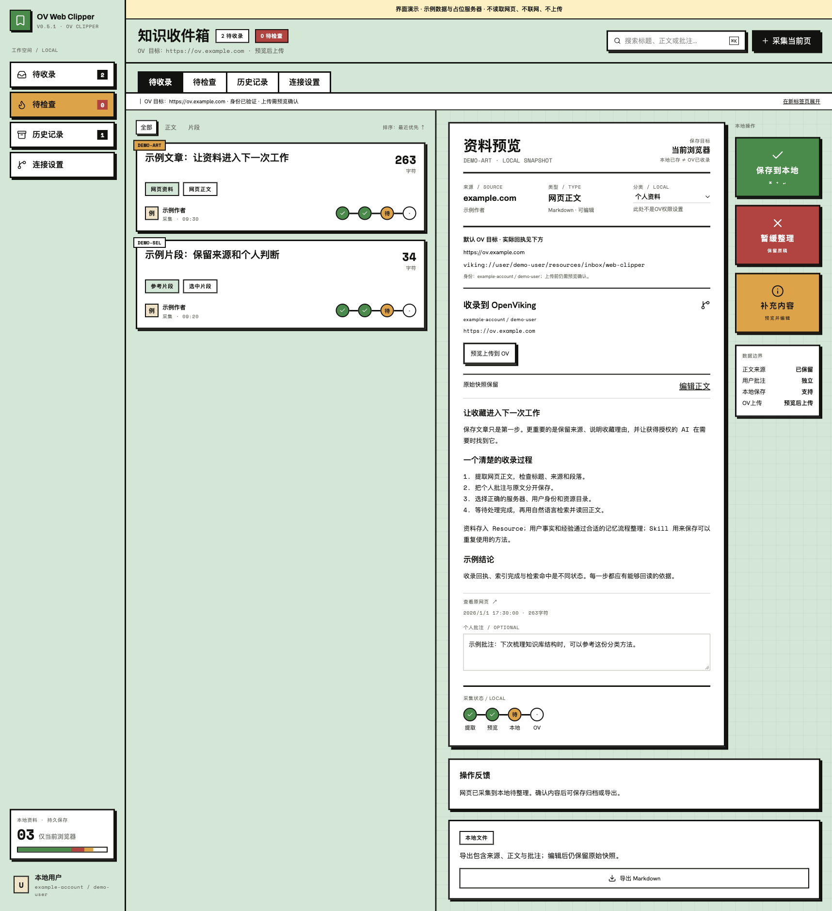
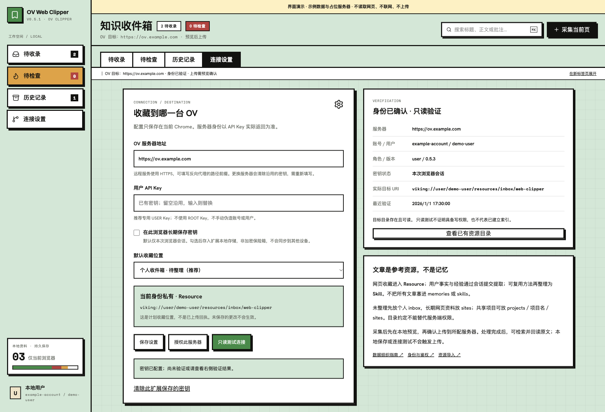
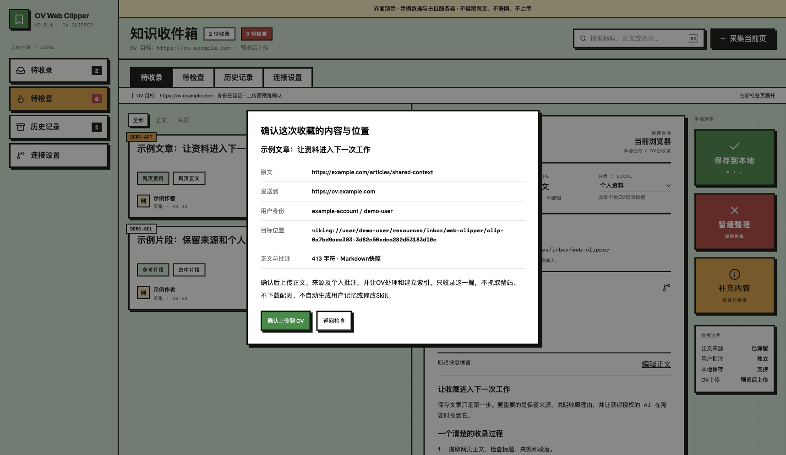
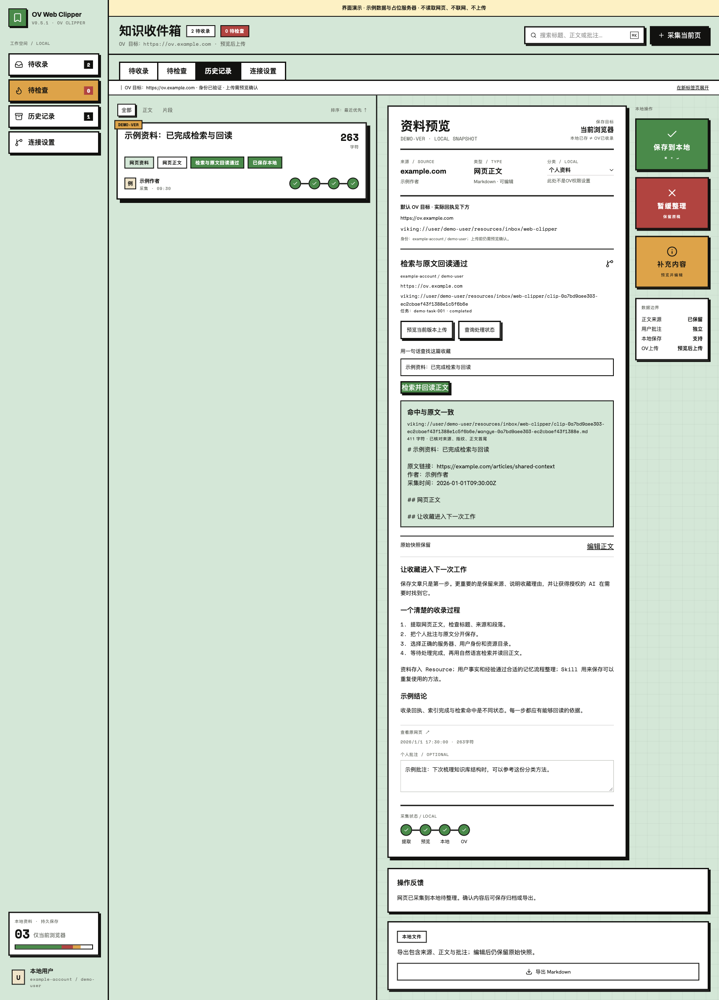

# OV Web Clipper

**看到值得留下的网页，直接收录到自己的 OpenViking。**

一个本地优先的 Chrome 网页采集扩展：提取正文或选中文字 → 预览、编辑与批注 → 确认目标后上传 → 查询处理状态 → 检索并读回原文。无需经过 Obsidian。

[中文图文介绍](https://www.mxiu.cc/ov-web-clipper-open-source/) · [下载安装包](https://github.com/pengqiancheng-sys/ov-web-clipper/releases/latest) · [安装与使用](docs/install.md) · [English](README.en.md) · [反馈问题](https://github.com/pengqiancheng-sys/ov-web-clipper/issues) · [参与讨论](https://github.com/pengqiancheng-sys/ov-web-clipper/discussions)

这是独立社区项目，非 OpenViking 官方产品；需要自备可用的 OpenViking 服务。源码采用 MIT 许可证。



> 本页四张截图来自同一套 React 界面的开发演示模式，使用原创示例文章、保留域名和模拟回执，顶部有“界面演示”标识。它们展示操作布局，不是生产服务器验收凭证。安装包不包含这些演示记录，也不预设任何人的服务器、身份或密钥。

## 它解决什么问题

浏览器书签只留下一个链接。复制聊天记录又容易丢掉来源和上下文。这个扩展把网页正文、来源链接、作者、采集时间与个人批注一起整理成 Markdown，放进你指定的 OV 资源目录，为后续授权的 AI 检索提供材料。

适合保存技术文章、研究资料、工作参考和短片段；在上传前确认“收藏了什么、发到哪台服务器、属于哪个用户”。

## 已有功能

- 点击工具栏采集当前网页；选中文字后通过右键菜单保存片段。
- Defuddle 在本机提取正文；保留采集快照，支持编辑正文、独立批注与 Markdown 导出。
- 本地收件箱、历史记录、全文搜索、失败状态筛选；适配侧边栏和完整工作区。
- 配置自己的 OV 地址、用户 API Key 和目标目录；按服务器单独申请访问权限。
- 从服务器返回值确认账号、用户、角色与资源位置，拒绝 ROOT/trusted 身份模式。
- 上传前二次预览；异步处理、状态查询、错误提示与相同内容重复上传保护。
- 处理完成后，使用自然语言检索并回读正文，校验来源、内容指纹和正文首尾。
- 请求结果不明时记录“状态待确认”，不盲目自动重试提交。

## 三步开始

1. 从 [Releases](https://github.com/pengqiancheng-sys/ov-web-clipper/releases/latest) 下载 `ov-web-clipper-0.5.1.zip`，解压。
2. 打开 Chrome 的 `chrome://extensions`，启用“开发者模式”，点击“加载已解压的扩展程序”，选择**直接包含 manifest.json 的目录**。
3. 打开扩展的“连接设置”，填写自己的 OV 地址与用户 Key，保存 → 授权此服务器 → 只读测试连接。打开文章后点击工具栏采集，检查内容再确认上传。

这是手动安装的开发者扩展，**尚未上架 Chrome 网上应用店，也没有自动更新**。完整步骤、升级注意事项和错误处理见 [安装与使用](docs/install.md)。

## 收藏放在哪里

| 用途 | 目标 URI |
| --- | --- |
| 个人收件箱（默认） | `viking://~/resources/inbox/web-clipper` |
| 个人长期网页资料 | `viking://~/resources/sites` |
| 共享项目网页资料 | `viking://resources/projects/<project>/sites` |

`~` 会根据服务器验证的当前用户展开；每篇内容位于以内容指纹生成的独立资源目录。网页属于 **Resource**，不会仅因收藏就成为用户事实、经验记忆或 Skill。

项目路径只是组织方式，**不等于权限隔离**。访问范围由 OV 的账号、用户和 ACL 决定；选择共享项目之前先核对权限。其他 AI 工具也必须接入同一授权服务器并实际调用检索，安装这个扩展不会自动替所有工具配置召回。



## 从上传到真正可用

| 状态 | 含义与下一步 |
| --- | --- |
| 已保存本地 | 仅在当前 Chrome 扩展中保存；还没进入 OV |
| 上传已受理 / OV 处理中 | 已获得提交回执；需查询任务状态 |
| 处理完成 | 任务完成；还需检索验证 |
| 检索与原文回读通过 | 本次查询命中目标，且回读原文校验通过；不代表所有问法都保证命中 |
| 状态待确认 | 网络或响应异常；先查询回执，不要反复上传 |





## 隐私、权限与边界

- 不预设公共云，不收集分析数据，不读取 Cookie 或浏览历史，不后台扫描页面。仅在明确操作后读取当前页或选区。
- API Key 默认保存在 `chrome.storage.session`；可选择本机持久保存到 `chrome.storage.local`。**本地扩展存储不是加密保险箱**，不会通过本项目同步到其他设备。更换服务器不会沿用旧服务器密钥。
- 上传会向所配 OV 服务发送文章内容、来源、作者、时间和批注；服务器的解析、向量化等后续处理可能调用它配置的模型并产生费用。请不要收录无权处理的内容。
- 扩展仅使用自带脚本和字体，不执行远程脚本。页面图片保留为 Markdown 链接，上传配置不下载远程媒体。
- 目前为 Markdown 文本工作流，不提供像素级网页存档、富文本渲染或跨设备本地数据同步。
- 单篇正文上限 1 MiB，本地总量约 6 MiB，最多 100 条。登录墙、复杂动态页面和 Chrome 内部页面不保证采集；不绕过站点访问限制。
- 手动安装更新前建议导出重要资料；移除扩展可能清除本地数据。扩展没有远程删除资源按钮，服务器资料按 OV 自身管理流程处理。

扩展使用 MV3，最低 Chrome 116。接口实现针对 OpenViking 0.5.x；开发期在 0.5.3 上验证过真实上传、异步状态与检索回读。其他版本需要自行验收，本公开包未重新替用户安装到实际浏览器。它不修改 OV 核心，也不运行备份、第二实例或 Bot。

## 开发

需要 Node.js **22.12+**（CI 使用 Node.js 24）和 npm。

```bash
npm ci
npm test
npm run build:extension
npm run audit:release
```

加载生成的 `dist/` 到 Chrome。`npm run dev` 仅用于界面开发，普通网页环境没有扩展能力；访问 `http://127.0.0.1:5173/?demo=1` 可查看标注清楚的演示模式，不采集、不上传、不连接 OV。生产构建会移除该演示分支。

```text
extension/             后台、正文提取、设置校验与 OV 客户端
src/                   React 界面、Tailwind CSS 与开发演示
scripts/               打包、许可证收集与发布检查
tests/                协议、身份、路径、状态及回读校验测试
docs/                 安装说明与脱敏截图
```

发布检查包含单元测试、独立构建、敏感内容规则扫描和包内许可证校验；[GitHub Actions CI](https://github.com/pengqiancheng-sys/ov-web-clipper/actions/workflows/ci.yml) 在 main 推送、PR 和手动触发时运行，使用只读仓库权限，不连接真实 OV、不读取生产密钥、不发布或部署。自动扫描不能替代人工审阅或完整安全审计。参见 [贡献指南](CONTRIBUTING.md)、[安全说明](SECURITY.md) 和 [版本记录](CHANGELOG.md)。

## 致谢与许可证

[OpenViking](https://github.com/volcengine/OpenViking) 提供上下文存储与检索；[Defuddle](https://github.com/kepano/defuddle) 提供正文提取。界面使用 React、Tailwind CSS、Lucide 与 Fontsource 字体。依赖名称、许可证及设计学习说明见 [THIRD_PARTY_NOTICES.md](THIRD_PARTY_NOTICES.md)。

欢迎提交 Issue、讨论使用场景与贡献 PR。请使用示例服务器和虚构资料复现问题，**不要上传自己的 Key、真实文章快照或后台日志**。
